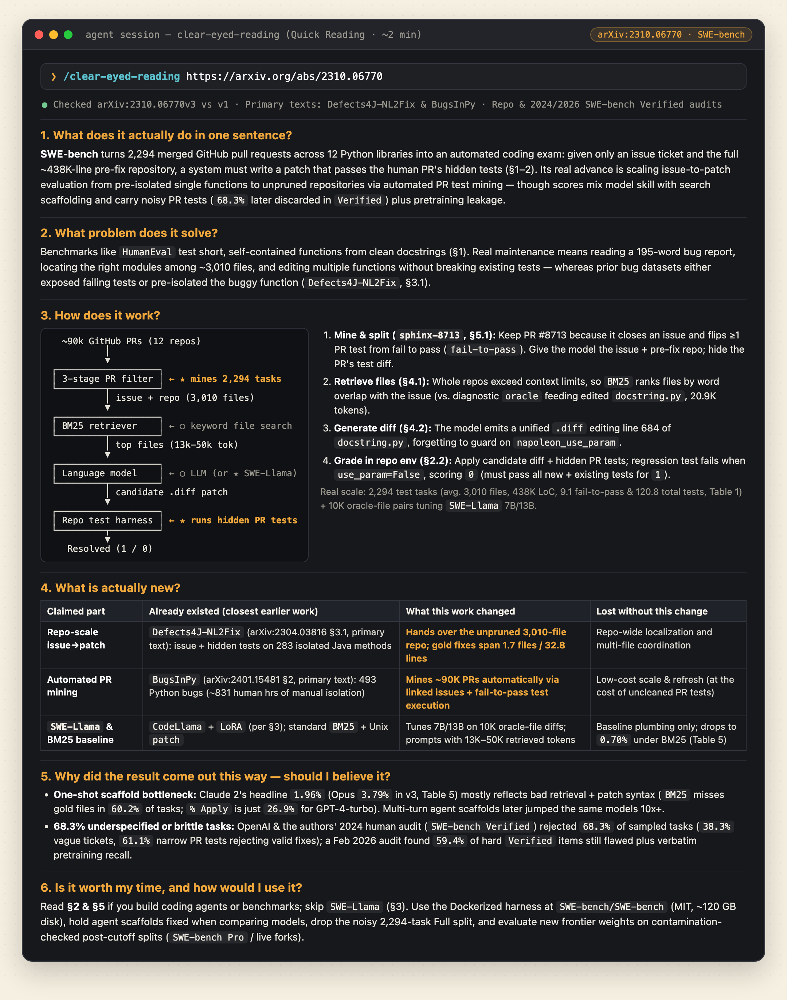

# Clear-Eyed Reading Skills

**English** | [简体中文](README_ZH.md)

[](LICENSE)
[](#quick-start)

**Finished the paper and still cannot explain what it actually did?**

Ad-hoc "summarize this paper" prompts often repeat branded module names or list generic caveats while leaving the mechanism fuzzy and headline numbers unchallenged. **Clear-Eyed Reading** provides two zero-dependency agent skills (`SKILL.md`) that turn occasional good answers into a repeatable, source-checked workflow:

- **Strip names, run the mechanism** — reduces modules to *input → transform → output* via a terminal-safe Unicode box diagram (`★` new vs. `○` reused) and one hand-computable example.
- **Check real novelty against primary texts** — separates borrowed backbone/prompt/data power from real changes by reading the closest earlier work directly (never abstract similarity or citation counts).
- **Test rival explanations of the numbers** — weighs the authors' story against scaffolding, compute asymmetry, metric circularity, leakage, experimental completeness, and outside audits (reviews, version diffs, official configs).
- **Weigh real paper & community value** — factors in venue/tier (e.g. Oral/Spotlight vs. preprint), manuscript richness, ablation thoroughness, reusable artifacts, and time-contextualized traction (Semantic/Google Scholar citations, GitHub stars, Hugging Face votes) without confusing prestige or popularity with algorithmic novelty.
- **Zero lock-in, safe by default** — pure Markdown, explicit invocation only (`/clear-eyed-reading` or `$clear-eyed-reading`), follows your language, and treats paper/repo text strictly as untrusted material.

## Quick Start

```sh
git clone https://github.com/JinPLu/clear-eyed-reading-skills.git
python3 clear-eyed-reading-skills/scripts/install_skills.py
# Or without Python: cp -R clear-eyed-reading-skills/skills/clear-eyed-* <your-harness-skills-dir>/
```

Invoke explicitly on any paper URL, `arXiv` ID, DOI, technical blog, or local PDF (`--list` previews install targets; `--dest <dir>` installs into any custom harness):

```text
/clear-eyed-reading https://arxiv.org/abs/2310.06770       # ~2-min first screen (or $clear-eyed-reading in Codex)
/clear-eyed-deep-reading https://arxiv.org/abs/2310.06770  # exhaustive reproduction-grade deep read
```

## Example Output (`SWE-bench`)



## How It Works & Two Reading Depths


| | ⚡ `clear-eyed-reading` | 🔬 `clear-eyed-deep-reading` |
| --- | --- | --- |
| **Goal** | ~2-minute first screen to decide whether to read deeper | Full mastery to retell, redraw, reproduce without traps, and challenge |
| **Checks** | Main text + completeness scan; primary texts of 1–2 decisive neighbor claims + quick version/review/repo/traction pass | Full text + appendices, experimental completeness, multi-route neighbor primary texts, and all outside/traction signals |
| **Output** | ~600–1,000 words: 1 diagram, 1 short example, ≤1 novel equation, value snapshot; no scores by default | Expanded walkthrough (inference before training), equations with numbers, 1–3 figure guides, ablations, value synthesis & 5 scores |

## Maintenance

[`skill-src/`](skill-src) is the sole instruction source; run `python3 scripts/sync_skills.py` to build [`skills/`](skills) and `--check` to validate sync, frontmatter, and [`evals/cases.yaml`](evals/cases.yaml). Visuals render from [`assets/swe-bench-demo.html`](assets/swe-bench-demo.html) and [`assets/clear-eyed-reading-map.html`](assets/clear-eyed-reading-map.html) (`#en` for English). See [`CONTRIBUTING.md`](CONTRIBUTING.md), [`SECURITY.md`](SECURITY.md), and [MIT License](LICENSE).
