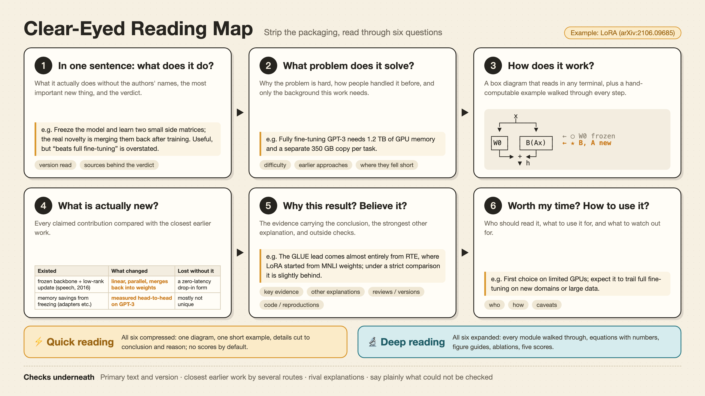

# Clear-Eyed Reading Skills

**English** | [简体中文](README_ZH.md)

[](LICENSE)
[](#installation-and-compatibility)

**Finished the paper and still cannot explain what it actually did?**

Ad-hoc "summarize this paper" prompts often echo the authors' module names or append generic limitation lists — leaving the mechanism fuzzy, borrowed capability hidden, and headline numbers unexamined. **Clear-Eyed Reading** packages two zero-dependency agent skills (`SKILL.md`) that turn occasional good answers into a repeatable, primary-text-checked reading workflow:

- **Strip names, hand-run the mechanism** — reduces branded modules to *input → transform → output* through one concrete miniature example and a terminal-safe Unicode box diagram (`★` added vs. `○` reused/external).
- **Separate borrowed power from real novelty** — traces what comes from pretrained backbones, external prompts, data filtering, or scale, and checks decisive claims against the **primary text** of the closest earlier work with explicit check tags (never abstract similarity or citation counts).
- **Explain why the numbers came out that way** — weighs the authors' story against rival causes (scaffolding, compute asymmetry, metric circularity, data leakage) and calibrates maturity via reviews, version diffs, official configs, and reproductions.
- **Two strict budgets, one standard** — `clear-eyed-reading` delivers a fast ~2-minute first screen (~600–1,000 words); `clear-eyed-deep-reading` builds a full reproduction-grade walkthrough with figure guides and 5-axis scores.
- **Zero lock-in, safe by default** — pure Markdown, explicit invocation only (`/clear-eyed-reading` or `$clear-eyed-reading`), follows your language, and treats paper/repo text strictly as untrusted material.

## Quick Start (30 seconds)

**1. Install** into existing personal skills folders (`~/.claude/skills`, `~/.codex/skills`, `~/.cursor/skills`, `~/.gemini/config/skills`, `~/.agents/skills`, etc.) — or copy the folders manually with no Python needed:

```sh
git clone https://github.com/JinPLu/clear-eyed-reading-skills.git
python3 clear-eyed-reading-skills/scripts/install_skills.py
# Or manual copy into any agent harness:
# cp -R clear-eyed-reading-skills/skills/clear-eyed-reading clear-eyed-reading-skills/skills/clear-eyed-deep-reading <your-skills-dir>/
```

**2. Run** explicitly on any paper URL, `arXiv` ID, DOI, blog post, or local PDF:

```text
# 2-minute first screen (slash command in Claude Code / Cursor, or $clear-eyed-reading in Codex)
/clear-eyed-reading https://arxiv.org/abs/2310.06770

# Exhaustive reproduction-grade deep read
/clear-eyed-deep-reading https://arxiv.org/abs/2310.06770
```

**3. Inspect a real output** — [jump to the live `SWE-bench` output below ↓](#real-output-example-swe-bench).



## How Every Answer Is Structured

Both skills answer the same six reader questions in order, localized to your language:

1. **In one sentence** — what it does without the authors' branding, the single most important new thing, the overall verdict, and exact version/sources checked.
2. **What problem does it solve?** — the concrete bottleneck and where earlier approaches fell short.
3. **How does it work?** — a plain-text Unicode box diagram (`★` new vs. `○` reused) plus one concrete miniature example carried from input to output; only non-trivial equations introduced or modified by the work are shown, with the example's numbers plugged in.
4. **What is actually new?** — a four-column table comparing every claimed contribution against the closest earlier work (with verification basis noted), separating real advances from relabeling — and naming undersold structural contributions too.
5. **Why did the result come out this way — should I believe it?** — the evidence carrying the result, the strongest rival explanation, and outside facts (reviews, v1→v3 edits, official code/configs, audits) that change the picture.
6. **Is it worth my time, and how would I use it?** — who should read or adopt it, practical caveats, maintained repos, and (in Deep Reading) five separate integer scores.

## Real Output Example: `SWE-bench`

Prompt: `Use $clear-eyed-reading to explain SWE-bench (arXiv:2310.06770) in plain English, show what is genuinely new, and explain how to read its benchmark scores.`

> **1-sentence verdict (excerpt):** SWE-bench turns 2,294 real GitHub issues across 12 popular Python libraries into an automated coding exam: given an issue ticket and the full pre-fix repository, a system must write a code patch that passes the human pull request's hidden tests (§1, §2.1–2.2). Its core advance is scaling natural-language bug fixing from pre-isolated single functions (`Defects4J-NL2Fix`) to unpruned, ~438K-line codebases through automated pull-request mining — though its scores mix model skill with search scaffolding and carry noisy PR tests (`68.3%` discarded in `SWE-bench Verified`) and pretraining leakage exposed by later audits.

```text
  ~90k GitHub PRs (12 Python repos)
           │
           ▼
┌─────────────────────┐
│ 3-stage PR filter   │  ← ★ mines 2,294 tasks with new failing-then-passing tests
└──────────┬──────────┘
           │ issue (195w) + repo (3,010 files)
           ▼
┌─────────────────────┐
│ BM25 file retriever │  ← ○ off-the-shelf keyword search (replaced by agents later)
└──────────┬──────────┘
           │ retrieved files (13k-50k tokens)
           ▼
┌─────────────────────┐
│ Language model      │  ← ○ existing LLM (or ★ LoRA-tuned SWE-Llama 7B/13B)
└──────────┬──────────┘
           │ candidate patch (.diff)
           ▼
┌─────────────────────┐
│ Repo test harness   │  ← ★ applies Unix patch + hidden PR tests in repo env
└──────────┬──────────┘
           │ all new + existing tests pass?
           ▼
  Resolved (1) or Unresolved (0)
```

<details>
<summary><b>Click to read the full unedited 2-minute Quick Reading output on SWE-bench (arXiv:2310.06770)</b></summary>

### 1. What does it actually do in one sentence?

SWE-bench turns 2,294 real GitHub issues across 12 popular Python libraries into an automated coding exam: given an issue ticket and the full pre-fix repository, a system must write a code patch that passes the human pull request's hidden tests (§1, §2.1–2.2). Its core advance is scaling natural-language bug fixing from pre-isolated single functions to unpruned, ~438K-line codebases through automated pull-request mining, showing that 2023–2024 frontier models solved under 4% in one pass (Table 1, Table 5). It became the standard coding-agent testbed, though its scores mix model skill with search scaffolding and carry noisy pull-request tests and pretraining leakage exposed by later audits.

*Scope:* Checked `arXiv:2310.06770v3` (Nov 2024) against `v1` (Oct 2023), primary texts of `Defects4J-NL2Fix` (`arXiv:2304.03816`) and `BugsInPy` (`arXiv:2401.15481`), [`SWE-bench/SWE-bench`](https://github.com/SWE-bench/SWE-bench), and the 2024/2026 `SWE-bench Verified` audits; Docker evaluations were not run locally.

### 2. What problem does it solve?

Benchmarks such as `HumanEval` ask a model to write one short, self-contained function from a docstring (§1). Real software maintenance requires reading an informal bug report, finding the relevant modules among thousands of files, and editing multiple functions without breaking existing behavior (§1, §2.3). Earlier datasets either gave failing tests without natural-language tickets or—like `Defects4J-NL2Fix`—isolated a single buggy method beforehand (`arXiv:2304.03816` §3.1), leaving repository-scale issue resolution unmeasured (§6).

### 3. How does it work?

*(Diagram shown above.)*

Trace real task `sphinx-doc__sphinx-8713` from input to score (§5.1, Figure 6):

1. **Task mining (offline):** From merged GitHub pull requests (PRs, proposed code changes), the filter keeps PR #8713 because it closes an issue, edits tests, and flips at least one test from failing before the fix to passing after (a `fail-to-pass` test, §2.1). The model receives only the issue text—Sphinx's `napoleon` extension ignores `napoleon_use_param = True` for `"Other Parameters"`—plus the pre-fix repo, while the PR's tests stay hidden (§2.2, §5.1).
2. **File selection:** Because whole repositories exceed prompt limits, `BM25` keyword search ranks files by word overlap with the issue (while a diagnostic lookup, called `oracle` retrieval, supplies the human-edited file `sphinx/ext/napoleon/docstring.py`, 20,882 tokens; §4.1, §5.1).
3. **Patch generation:** Given the issue, selected files, and a format example, the model outputs a unified `diff` patch editing `_parse_other_parameters_section` at line 684 without checking `napoleon_use_param` (§4.2, §5.1).
4. **Execution grading:** Unix `patch` applies the diff plus hidden PR tests in the pre-fix environment; `test_parameters_with_class_reference` fails when `napoleon_use_param = False`, scoring `0` rather than `1` (§2.2, §5.1).

Full scale spans 2,294 test tasks across 12 Python packages (averaging 3,010 files, 438K lines, 9.1 `fail-to-pass` and 120.8 total tests; Table 1), plus 10,000 ≤30K-token `oracle`-file training pairs from 37 disjoint repos used to fine-tune `CodeLlama-Python` with low-rank adapters (`LoRA`) into `SWE-Llama` 7B/13B (§3).

### 4. What is actually new?

| Part | Already existed (closest earlier work) | What this work changed | Lost without this change |
| --- | --- | --- | --- |
| Repo-scale issue-to-patch task (`SWE-bench`, §2.1–2.3) | `Defects4J-NL2Fix` (`arXiv:2304.03816` §1, §3.1, primary text checked): issue + hidden trigger/regression tests on 283 single-method Java bugs | Supplies the unpruned Python repo (avg. 3,010 files; gold fixes edit 1.7 files, 32.8 lines, Table 1) | Repo-wide fault localization and coordinated multi-file edits |
| Automated 3-stage PR mining (§2.1, §2.3) | `BugsInPy` (`arXiv:2401.15481` §1–2, primary text checked): 493 Python bugs with fail-to-pass tests (~831 human hours) | Filters ~90K PRs into 2,294 test + 19K train tasks automatically via linked issues and test execution | Low-cost scale and continuous refresh (at the cost of losing manual commit isolation) |
| Filtered 300-task subset (`SWE-bench Lite`, §2.4, added in `v2`/`v3`) | Full `SWE-bench` (§2.1) | Subsamples 300 self-contained bug fixes across 11 repos | Cheaper evaluation runs; no new mechanism |
| Training split & tuned models (`SWE-bench-train`, `SWE-Llama` 7B/13B, §3) | `CodeLlama-Python` + `LoRA` (per §3, primary texts not rechecked) | Tunes on 10K oracle-file issue-to-diff pairs from 37 disjoint repos | Open 7B/13B models emitting valid diffs (~52–54% apply rate, Table 5) |
| Retrieval + diff baseline (§4.1–4.2) | `BM25` + Unix `patch` (standard) | Prompts models with top `BM25` files (13K–50K tokens) | Nothing structural; baseline plumbing |

The real advance is benchmark engineering: uniting `Defects4J-NL2Fix`'s issue-to-hidden-test setup with `BugsInPy`'s Python repositories while replacing ~831 hours of manual bug isolation with automated PR test filtering. `SWE-Llama` and `BM25` are standard baselines, and skipping manual PR screening let tangled tests slip into the exam.

### 5. Why did the result come out this way — and how should I read SWE-bench scores?

To read any SWE-bench score—from Claude 2's `1.96%` (`v1` Table 2; `1.97%` in `v3` Table 5) and Claude 3 Opus's `3.79%` (`v3` Table 5) to 70%+ leaderboard claims—separate four factors inside `% Resolved`:

- **All-or-nothing grading (`% Resolved` vs. `% Apply`):** A patch scores `1` only if it applies cleanly and passes every `fail-to-pass` test plus existing tests that must stay green (`pass-to-pass`, §2.2–2.3). Malformed diffs alone wipe out half to three-quarters of baseline attempts (`% Apply`: `26.9%` GPT-4-turbo, `43.1%` Claude 2, Table 5), and applied model diffs average 1 file and ~20 lines versus 74.5-line human patches (Table 8).
- **Measures model plus scaffold:** One-shot `BM25` misses at least one ground-truth file in `60.2%` of tasks at 27K tokens (Table 3). Supplying exact edited files (`oracle`) lifts Claude 2 to `4.8%` (§5), and trimming unedited lines ±15 (`oracle-collapsed`) reaches `5.93%` (Claude 2) and `9.39%` (Claude 3 Opus, Table 6). Wider 50K `BM25` windows *lower* Claude 2 to `1.22%` via distraction (Table 2, Figure 5), and `SWE-Llama 13B` drops from `~4.0%` (`oracle`, Table 7) to `0.70%` (`BM25`, Table 5) due to `oracle`-only training (§5). Later 10x leaderboard gains came largely from multi-turn agent scaffolds (search, shell, iterative test runs).
- **Split choice and flawed PR tests (`Full` vs. `Lite` vs. `Verified`):** `Lite` (300 tasks, §2.4) drops sprawling and visual tickets (`32%` of `matplotlib` issues embed image URLs, §5). Worse, an August 2024 human audit by OpenAI and the authors ([`SWE-bench Verified`](https://openai.com/index/introducing-swe-bench-verified/), 500 tasks) discarded `68.3%` of sampled original tasks—`38.3%` for vague prompts and `61.1%` for narrow or multi-issue PR tests that reject valid fixes (e.g., importing a PR-invented helper name); a [February 2026 audit](https://openai.com/index/why-we-no-longer-evaluate-swe-bench-verified/) of 138 hard `Verified` tasks found `59.4%` still rejected valid code. Full SWE-bench understates capability, while `Verified` roughly doubles scores (`Agentless`: `16%` → `32%`) yet hits a noisy ceiling well below 100%.
- **Pretraining leakage:** While pre- vs. post-2023 `oracle` scores barely shifted for Claude 2 (`4.87%` vs. `4.23%`, Table 7; GPT-4 fell from `1.96%` on a 25% subset to `0.0%`), the February 2026 audit caught frontier models recalling verbatim gold patches and release-note parameter names from public GitHub data, prompting OpenAI to retire `Verified` for `SWE-bench Pro`.

### 6. Is it worth my time, and how would I use it?

Read §2 and §5 if you build coding agents or execution benchmarks; skip `SWE-Llama` (§3), now superseded by tool-using agents and stronger open weights. Maintained code, datasets (`princeton-nlp/SWE-bench`), and the June 2024 Dockerized harness—added to fix host-OS setup flakiness—live at [`SWE-bench/SWE-bench`](https://github.com/SWE-bench/SWE-bench) (MIT license; needs `x86_64` Docker and ~120 GB disk). For evaluations today, hold the agent scaffold and retry budget fixed when comparing models, avoid the noisy 2,294-task Full split, and prefer contamination-audited or post-cutoff splits (`SWE-bench Pro`, `SWE-bench Multimodal`, or fresh tasks mined with SWE-bench's open pipeline).

</details>

## Choose the Reading Depth

| | ⚡ `clear-eyed-reading` | 🔬 `clear-eyed-deep-reading` |
| --- | --- | --- |
| **Use it for** | Fast 1–3 minute first screen to decide whether to invest more | Full mastery before retelling, reproducing, reusing, or challenging the method |
| **How far it checks** | Main text core by default (skips appendices); primary-text checks on the 1–2 decisive neighbor claims plus one lightweight version/review/repo pass | Full text, appendices, decisive figures, equations, implementation, multi-route primary-text checks across claims, and all six kinds of outside material |
| **Output** | Six tight sections (~600–1,000 English words, excluding diagram): one diagram, one short worked example, at most one novel core equation; no scores by default | All six sections expanded: every module walked through with one shared example (inference before training), equations with numbers, figure guides, ablations, five scores |
| **What you can do next** | See what is really there and decide whether to skip or go deep | Explain, redraw, reproduce without traps, and challenge the method |

Demystifying is not fault-finding, and it never discounts simple, engineering-heavy, negative, or early work just for being simple — an undersold structural contribution gets named just as plainly as an inflated claim. Without the decisive primary-text comparisons, novelty and significance scores are withheld rather than guessed. Without subagents, the skill runs the same checks sequentially.

## Installation and Compatibility

Both directories under [`skills/`](skills) are self-contained artifacts with no runtime dependencies, specific model lock-in, MCP requirement, or forced output language:

- **Auto-discover personal harnesses** (`~/.claude/skills`, `~/.codex/skills`, `~/.cursor/skills`, `~/.gemini/config/skills`, `~/.gemini/skills`, `~/.agents/skills`, `~/.config/opencode/skills`, `~/.copilot/skills`, `~/.hermes/skills`, `~/.kiro/skills`):
  ```sh
  python3 scripts/install_skills.py
  ```
- **Preview or target a custom skills folder**:
  ```sh
  python3 scripts/install_skills.py --list
  python3 scripts/install_skills.py --dest /path/to/your-harness/skills
  ```
- **Upgrading**: `install_skills.py` automatically removes legacy `clear-eyed-paper-reading` and `clear-eyed-paper-deep-reading` folders if present.

🛡️ Article contents, repositories, and reviews are treated strictly as untrusted material; neither skill executes embedded code or uploads unpublished material without explicit permission.

## Maintenance and Contributing

[`skill-src/`](skill-src) is the sole instruction source. Run `python3 scripts/sync_skills.py` to regenerate [`skills/`](skills) and `python3 scripts/sync_skills.py --check` to validate sync, YAML frontmatter, and [`evals/cases.yaml`](evals/cases.yaml). The reading map is rendered from [`assets/clear-eyed-reading-map.html`](assets/clear-eyed-reading-map.html) (append `#en` for English). See [`CONTRIBUTING.md`](CONTRIBUTING.md) and [`SECURITY.md`](SECURITY.md). Released under the [MIT License](LICENSE).
