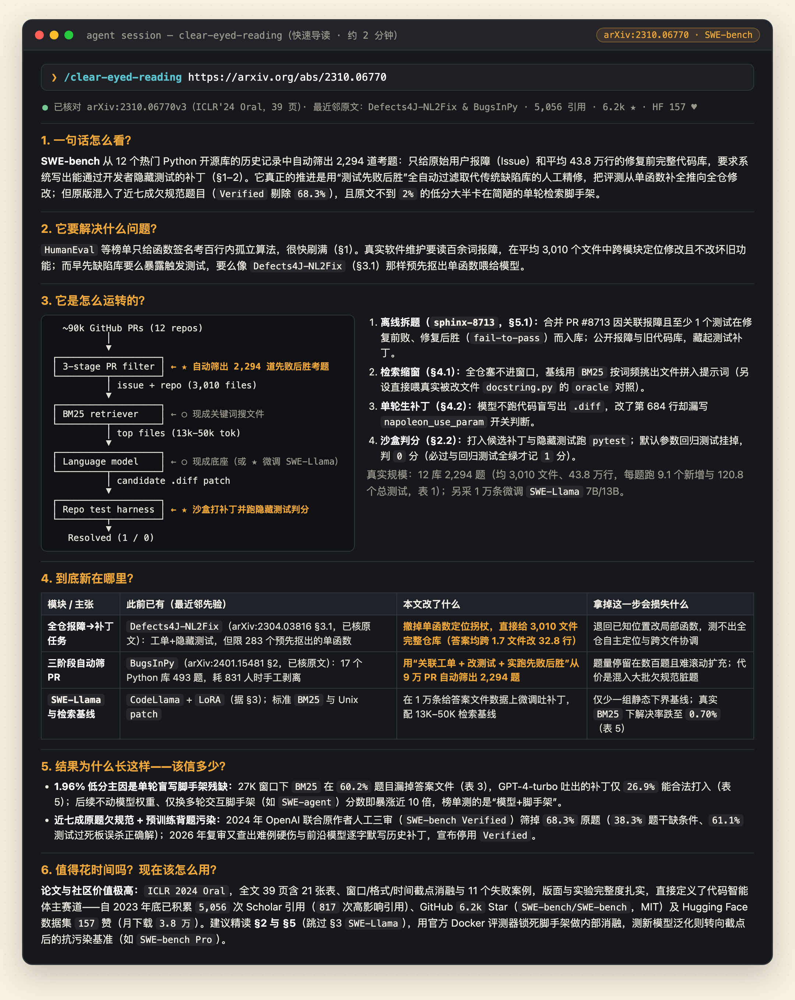
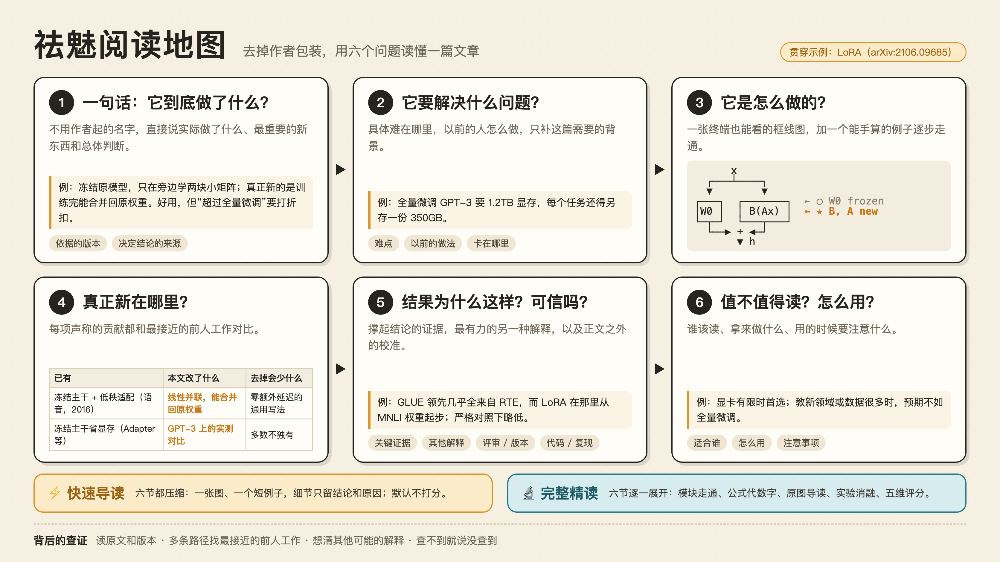

# 祛魅阅读 Skills

[English](README.md) | **简体中文**

[](LICENSE)
[](#极速上手)

**论文读完了，却还是说不清它到底做了什么？**

随手让大模型“总结这篇论文”，往往顺着作者的新名字当复读机，或在末尾列一串套话局限——机制没走通，底座给的能力被算成作者创新，主表高分从哪来也说不清。**祛魅阅读（Clear-Eyed Reading）** 是一对零依赖的 Agent 阅读技能（`SKILL.md`），把“偶尔答得好”变成每次都按原文对账的稳定读法：

- **剥掉名字，手算跑通机制** —— 把模块还原成“输入 → 变换 → 输出”，配终端零错位的 Unicode 框线图（`★` 新增 / `○` 借用）和一个能手算走完的具体小例子。
- **读最近邻原文对账真增量** —— 拆清能力来自本文还是预训练底座、提示词或数据筛选，直接读最接近的前人原文对比（绝不用引用量或摘要相似度充数）。
- **追问结果背后的替代解释** —— 对照脚手架差异、算力不对称、指标自证循环、实验完整度与数据泄漏，并用审稿、版本删改、官方配置和独立审计校准成熟度。
- **综合衡量论文与社区价值** —— 将期刊/会议档位（如 Oral/Spotlight 与预印本）、版面丰富度、消融完整度、开源资产价值及按发表时间解读的客观热度（Scholar 引用、GitHub Star、Hugging Face Vote）纳入阅读与复用参考，同时严防把头衔或热度误当成算法首创。
- **零平台绑定，默认安全** —— 纯 Markdown 自包含目录，仅显式调用触发（`/clear-eyed-reading` 或 `$clear-eyed-reading`），跟随提问语言，且把文章与仓库严格视为不可信材料。

## 极速上手

```sh
git clone https://github.com/JinPLu/clear-eyed-reading-skills.git
python3 clear-eyed-reading-skills/scripts/install_skills.py
# 或无需 Python 直接复制：cp -R clear-eyed-reading-skills/skills/clear-eyed-* <你的skills目录>/
```

对任意论文链接、`arXiv` 编号、DOI、技术博客或本地 PDF 显式调用（`--list` 预览检测到的安装目录，`--dest <dir>` 指定任意平台目录）：

```text
/clear-eyed-reading https://arxiv.org/abs/2310.06770       # 约 2 分钟首屏快筛（Codex 等用 $clear-eyed-reading）
/clear-eyed-deep-reading https://arxiv.org/abs/2310.06770  # 复现级完整精读
```

## 运行示例（`SWE-bench`）



## 阅读框架与快慢两档



| | ⚡ `clear-eyed-reading` | 🔬 `clear-eyed-deep-reading` |
| --- | --- | --- |
| **目标** | 约 2 分钟首屏快筛，决定值不值得继续读 | 彻底吃透，能够复述、重画、避坑复现并独立质疑 |
| **核查深度** | 正文核心+实验完整度快扫；核对 1–2 篇决定性近邻原文 + 一次版本/审稿/仓库/社区热度快检 | 全文+附录、实验与版面完整度、多路径近邻原文，并系统核查全部正文外证据与社区牵引力指标 |
| **输出粒度** | 约 900–1,500 字：1 张框线图、1 个短例子、≤1 个新公式、价值快照；默认不打分 | 逐模块共用同一例子走通（先推理后训练）、关键公式代数字、1–3 张原图导读、消融、综合价值与五维评分 |

## 维护与贡献

[`skill-src/`](skill-src) 是唯一指令源码；运行 `python3 scripts/sync_skills.py` 生成 [`skills/`](skills)，`--check` 校验生成同步、frontmatter 与 [`evals/cases.yaml`](evals/cases.yaml)。配图由 [`assets/swe-bench-demo.html`](assets/swe-bench-demo.html) 与 [`assets/clear-eyed-reading-map.html`](assets/clear-eyed-reading-map.html) 渲染（加 `#en` 为英文版）。详见 [`CONTRIBUTING.md`](CONTRIBUTING.md)、[`SECURITY.md`](SECURITY.md) 与 [MIT License](LICENSE)。
